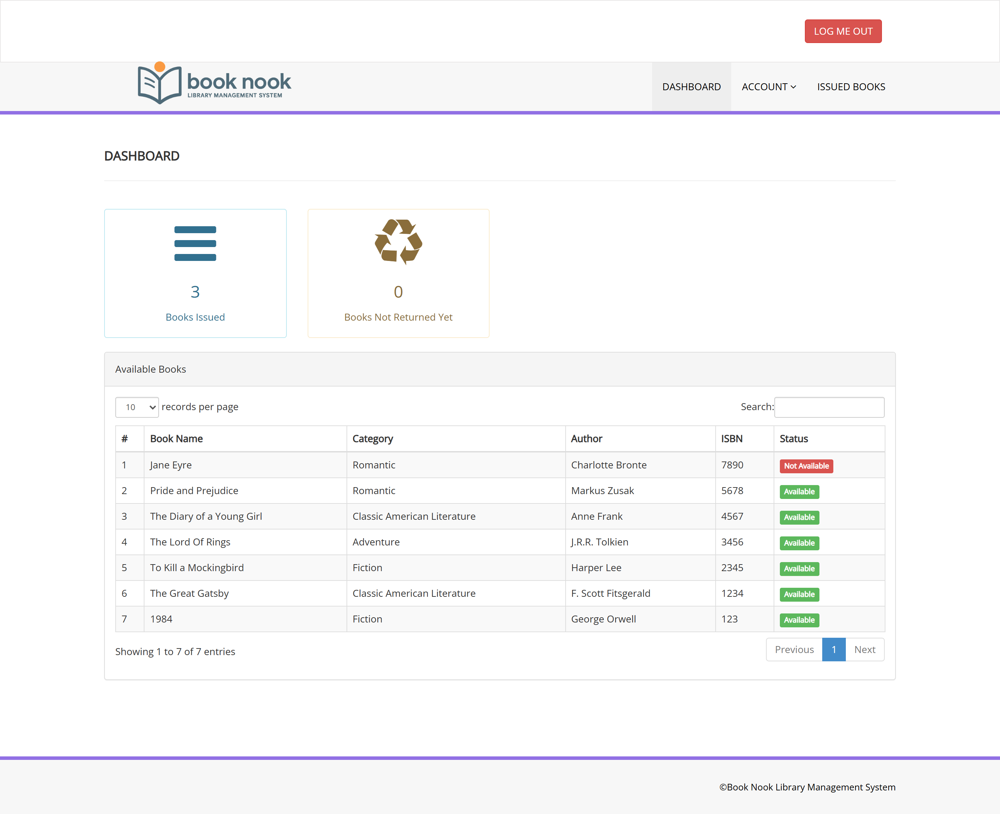
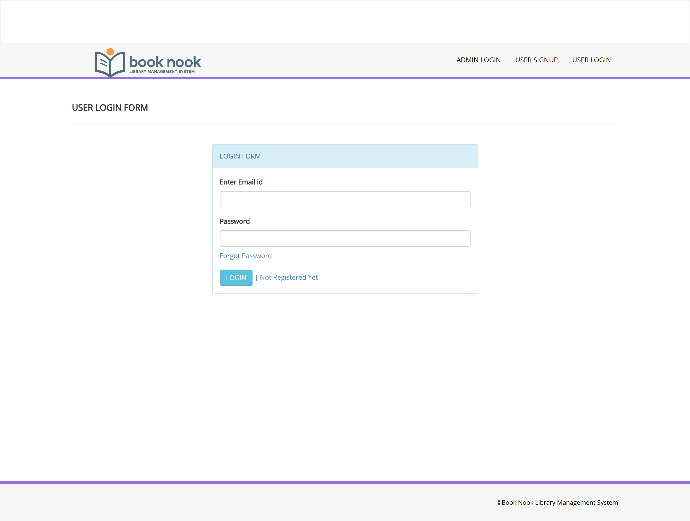
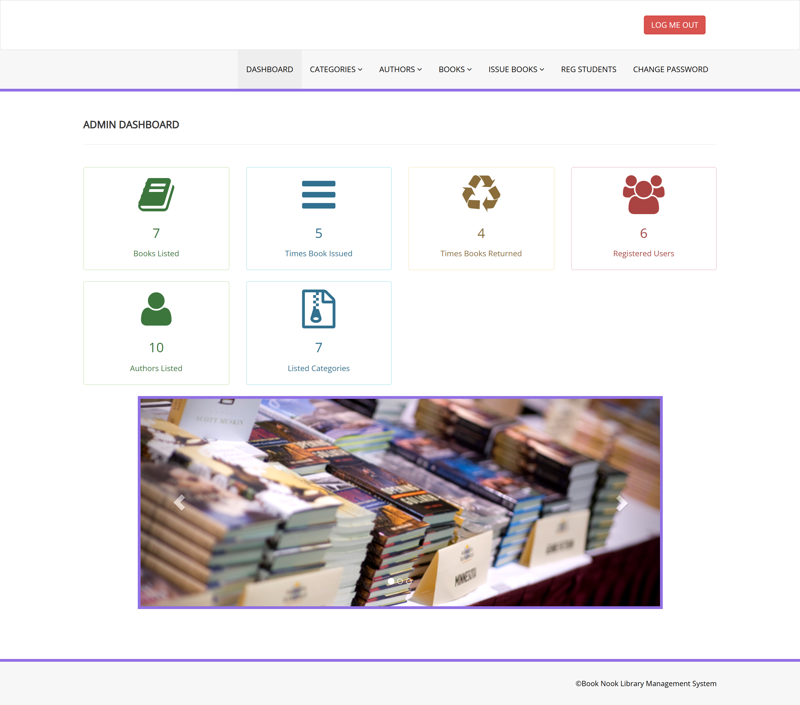
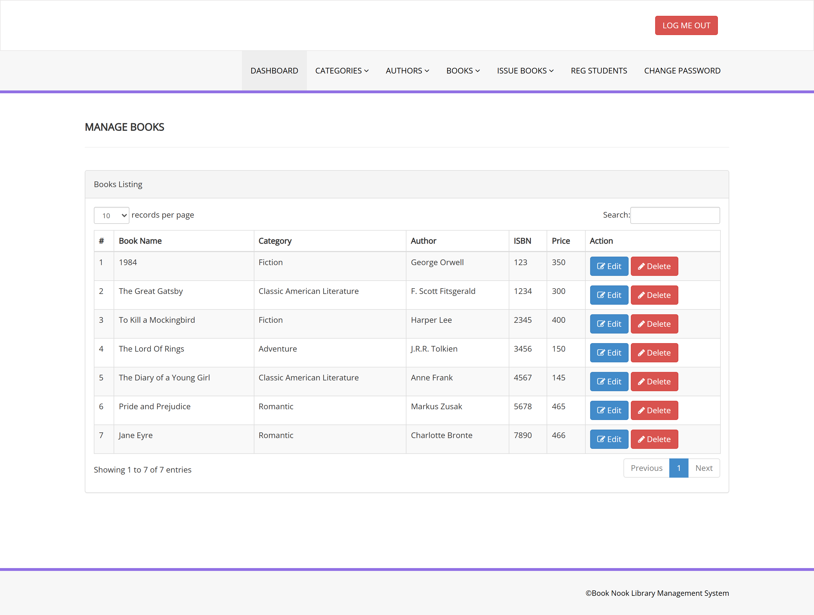
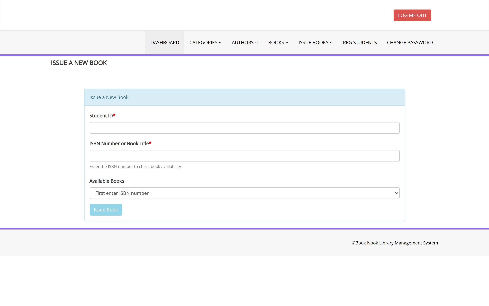
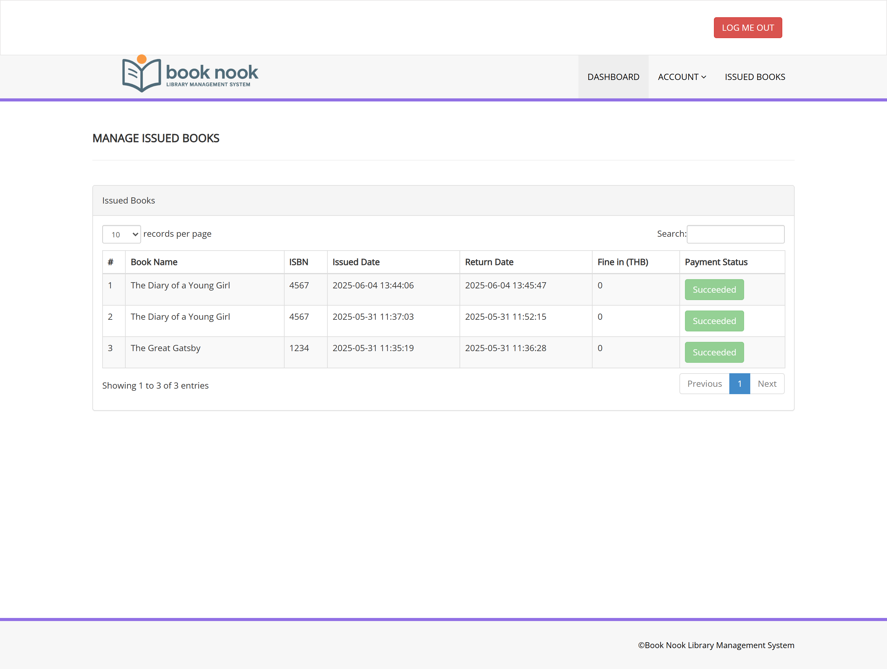
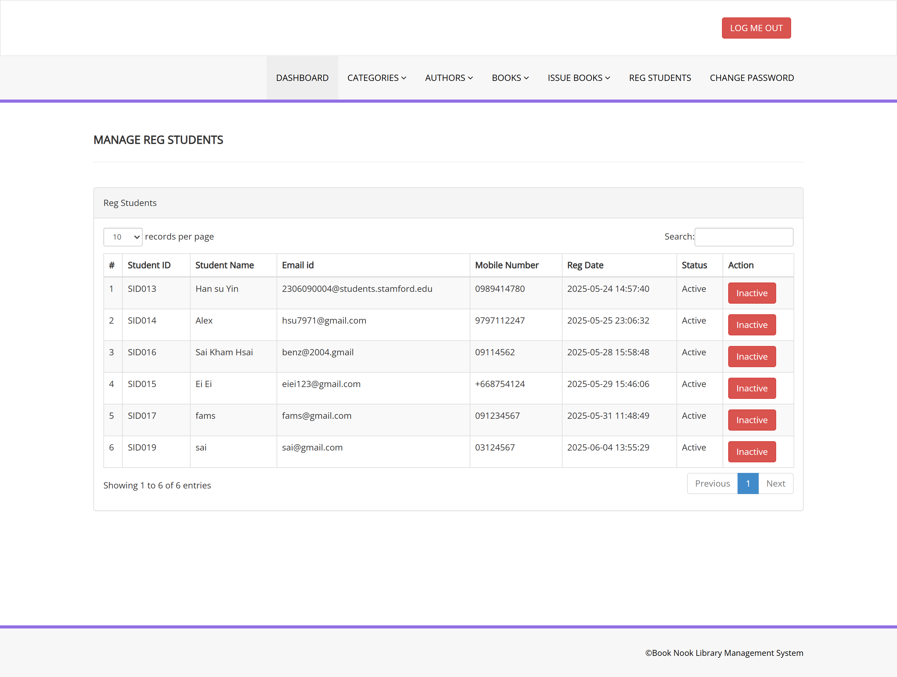

# Book Nook – Library Management System

A web-based library management system built with **PHP**, **MySQL** and **Bootstrap 3**.
Students can browse books, see what they have borrowed and pay overdue fines.
Librarians (admins) manage the catalogue, issue and return books, and look after student accounts.

A static demo (no PHP needed) is in [`netlify-demo/`](netlify-demo/README.md).



## Features

### Student
- Sign up, log in, recover a forgotten password and change password
- Dashboard with book availability
- List of issued books with return status and fines
- Pay fines through a card form (basic validation only, no real charge)
- View and update their profile

### Admin
- Dashboard with library statistics
- Add, edit and delete **categories**, **authors** and **books**
- Issue books, with live lookup by student ID and ISBN
- Record book returns and fines
- View registered students and block or unblock them
- Change the admin password

## Tech stack

| Layer    | Technology                                   |
|----------|----------------------------------------------|
| Backend  | PHP (PDO)                                    |
| Database | MySQL / MariaDB                              |
| Frontend | HTML, Bootstrap 3, jQuery, DataTables        |
| Tooling  | Composer (`stripe/stripe-php`)               |

## Project structure

```
.
├── library/              # PHP application (put this folder in htdocs)
│   ├── admin/            # Admin panel
│   ├── includes/         # config.php (DB connection), header, footer
│   ├── assets/           # CSS, JS, fonts, images
│   └── *.php             # Student-facing pages
├── sql file/library.sql  # Database schema and sample data
├── netlify-demo/         # Static demo version for Netlify
├── screenshots/          # App screenshots
└── ERD Library.png       # Entity-relationship diagram
```

## Getting started (XAMPP)

1. **Install** [XAMPP](https://www.apachefriends.org/) and start **Apache** and **MySQL**.
2. **Copy the app.** Clone this repo and place the `library/` folder in `xampp/htdocs/`:
   ```bash
   git clone https://github.com/thecynthiayin/Library-Management-System.git
   ```
3. **Create the database.** Open <http://localhost/phpmyadmin>, create a database named `library`,
   then import `sql file/library.sql`.
4. **Install PHP dependencies** (the `vendor/` folder is not committed):
   ```bash
   cd library
   composer install
   ```
5. **Check the database settings** in `library/includes/config.php` and `library/admin/includes/config.php`.
   The defaults match a fresh XAMPP install:
   ```php
   define('DB_HOST','localhost');
   define('DB_USER','root');
   define('DB_PASS','');
   define('DB_NAME','library');
   ```
6. **Open the app:**
   - Student portal: <http://localhost/library/>
   - Admin portal: <http://localhost/library/adminlogin.php>

## Database

The `library` database has six tables:

| Table                  | Purpose                                   |
|------------------------|-------------------------------------------|
| `admin`                | Admin accounts                            |
| `tblstudents`          | Registered students                       |
| `tblcategory`          | Book categories                           |
| `tblauthors`           | Authors                                   |
| `tblbooks`             | Book catalogue (ISBN, category, author)   |
| `tblissuedbookdetails` | Issued books, return dates and fines      |


## Screenshots

| Student login | Admin dashboard |
|---|---|
|  |  |
| **Manage books** | **Issue book** |
|  |  |
| **Issued books (student)** | **Registered students** |
|  |  |

More screenshots are in the [`screenshots/`](screenshots) folder.

## Security note

This is a learning project. Passwords are stored as MD5 hashes, which are not secure for production use.
Before deploying it publicly, switch to `password_hash()` / `password_verify()` and use a non-root database user.
